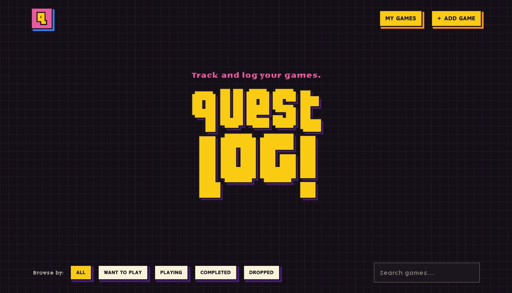

# Questlog 🎮




**[🔗 Demo](https://questlog-tracker.vercel.app/)**

## Om projektet

**Questlog** är en så kallad spelbacklog där du kan lista de spel du vill spela,
spelar just nu, har klarat eller lagt ner. Applikationen är byggd i React med
TypeScript och hämtar, skapar, ändrar och tar bort spel i Questlog API
tillsammans med eget uppbyggt API i MongoDB med Vercel Functions.

### För inlämning

- **Handle:** `lina-j`
- **Betyg jag siktar på:** VG

## Funktioner

- Lista alla spel, med filter för status: All, Want to play, Playing, Completed
  och Dropped
- Valt filter sparas i LocalStorage och finns kvar vid omladdning med hjälp av
  en custom hook
- Sök på spelets titel
- Sida för varje spel med omslag, plattform, betyg, anteckningar och från eget
  api, kategorier och extra bild
- Lägg till, ändra eller ta bort spel
- Laddningsindikator
- 404-sida för sidor som inte finns
- Responsiv design

## Kom igång

```bash
git clone https://github.com/linasvard/questlog.git
cd questlog/questlog_app
npm install
npm run dev
```

Öppna servern i `http://localhost:5173`

Spelen hämtas från Questlog API och fungerar direkt. Kategorier och extra bild
hämtas från mitt eget API på Vercel. I utvecklingsläget skickar Vite vidare
anrop till `/api` till den deployade versionen (se `server.proxy` i
`vite.config.ts`).

### Kör det egna API:et lokalt (frivilligt)

1. Skapa en `.env` i projektets rot:

```
MONGODB_URL=mongodb+srv://...
```

2. Starta API:et:

```bash
npx vercel dev
```

3. API:et svarar på `http://localhost:3000/api/extras`.

## Custom hooks

All logik för att hämta och spara data ligger i egna hooks. Komponenterna
anropar aldrig `fetch` själva, utan får färdig data, laddningsstatus och fel
från en hook.

| Hook                                 | Gör                                                                                                                                            |
| ------------------------------------ | ---------------------------------------------------------------------------------------------------------------------------------------------- |
| `useGames()`                         | Hämtar alla spel. Returnerar `{ games, isLoading, error }`.                                                                                    |
| `useGame(gameId)`                    |  Hämtar ett spel och dess extra information (kategorier och bild) samtidigt med `Promise.all`. Returnerar `{ game, extra, isLoading, error }`. |
| `useSaveGame()`                      | Samlar POST, PATCH och DELETE. Returnerar `{ createGame, editGame, removeGame, isSaving, error }`.                                             |
| `useLocalStorage(key, initialValue)` | Fungerar som `useState` men sparar värdet i `LocalStorage`. Används för statusfiltret och sökrutan.                                            |

### Hur de fungerar

- **`useGames` och `useGame`** hämtar data i en `useEffect` och håller reda på
  tre saker: datan, om den laddar och om något gick fel. `useGame` hämtar spelet
  från Questlog och extras från mitt egna API **samtidigt**, så att sidan inte
  behöver vänta på två anrop efter varandra. Svarar inte mitt egna API visas
  spelet ändå, bara utan extras.
- **`useSaveGame`** har en gemensam hjälpfunktion som sköter laddning och fel
  för alla tre anropen. När ett spel sparas delas formulärets värden upp: titel,
  plattform, status, betyg, omslag och anteckningar skickas till Questlog API,
  medan kategorier och extrabilden skickas till mitt egna API. Tas ett spel bort
  tas även dess extras bort.
- **`useLocalStorage`** läser det sparade värdet en gång när komponenten startar
  och sparar det igen varje gång det ändras. Värdet omvandlas till och från
  JSON, så hooken fungerar för alla typer. Om `localStorage` inte går att
  använda faller den tillbaka till sitt startvärde.

### Varför bygga så?

- **Komponenterna blir enklare.** En sida behöver bara skriva
  `const { game, isLoading, error } = useGame(gameId)` och fokusera på vad som
  ska visas, inte hur datan hämtas.
- **Ingen upprepning.** Detaljsidan och redigeringssidan hämtar samma data. Med
  en hook skrivs logiken en gång.
- **Lätt att ändra.** Ändras API:et, eller lägger jag till ett API till som jag
  gjorde med kategorierna, ändrar jag i hooken. Komponenterna påverkas inte.
- **Samma mönster överallt.** Alla hooks returnerar data, laddning och fel på
  samma sätt, så sidorna hanterar dem likadant.

## Eget API för kategorier och extra bild

Questlog API sparar bara de fält det har i sin modell, så kategorier kunde inte
sparas där. Jag tog då beslutet att bygga ett mindre API med Vercel Functions
och MongoDB. Det kopplas ihop med spelen via spelets `id` från Questlog API.

| Metod  | URL                      | Gör                                                          |
| ------ | ------------------------ | ------------------------------------------------------------ |
| GET    | `/api/extras?gameId=...` | Hämtar kategorier och extra bild för ett spel, eller 404     |
| POST   | `api/extras`             | Skapar eller uppdaterar: `{ gameId, categories, inGameUrl }` |
| DELETE | `api/extras?gameId=...`  | Tar bort ett spels extras                                    |
